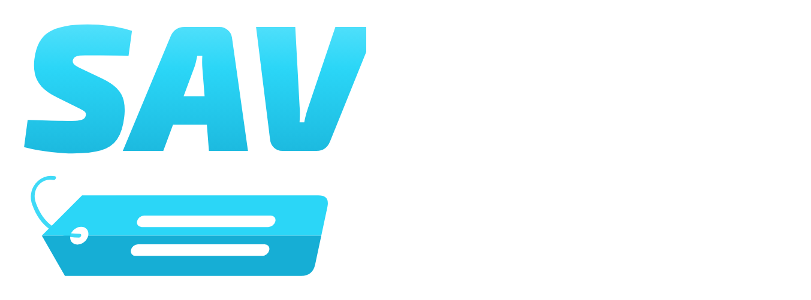
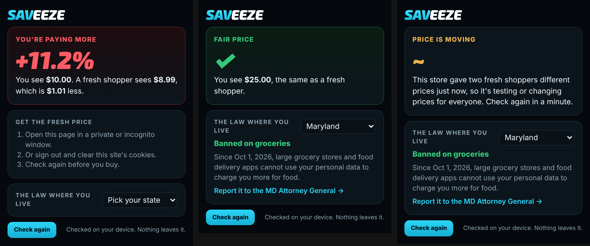

<p align="center"></p>

<p align="center"><b>See if a store is charging you more than everyone else.</b><br>One fair price, for everyone.</p>

---

Stores have started using your data to guess the most you'll pay, then showing you that price. Not the same price for everyone. Your price.

In December 2025, Consumer Reports had 437 people buy the same groceries on Instacart. Every single one of them was in a pricing test. The same box of cereal went from $2.99 to $3.69 depending on who was looking. New York now makes stores warn you when your data set the price, Maryland banned it for groceries in October 2026, and the FTC has proposed rules for 2027.

But there was no simple way for a normal shopper to check. So I built one.

<p align="center"></p>

## How it works

You open a product and click savEEZE. At the same moment it loads that product three times:

1. **As you**, with your normal sign-in and history.
2. **As a fresh shopper**, with no cookies, no sign-in, nothing the store can recognise.
3. **As another fresh shopper**, a second later.

All three are read the exact same way, so the only thing that's different is whether the store knows it's you. Then you get a straight answer:

| You see | It means |
|---|---|
| **+12%** in red | You're paying more than a stranger would |
| **✓** in green | Same price as everyone |
| **−5%** in blue | You're getting a better deal, usually a member price |
| **~** in yellow | The two fresh shoppers got different prices too, so the store is moving prices for everyone right now, not just you |

That last one matters. Stores run random price tests all the time. If savEEZE only compared you to one stranger it would blame you for a test that has nothing to do with you. Two strangers keeps it honest.

It also tells you what the law says in your state, links you to the right place to report it, and highlights it if the page shows New York's "this price was set by an algorithm using your personal data" warning.

## Stores

Built and tested on **Amazon, Walmart, Target, Best Buy and Home Depot**. It also works on any shop that publishes standard product data on its pages, which is most of them.

Target draws its price after the page loads, so for Target savEEZE asks Target's own price service twice, once with your visitor id and once with a brand-new one.

## Privacy

Everything happens in your browser. savEEZE has no server, no account, no tracking and no analytics. It only runs on a page when you click it, and the only thing it saves is the state you pick. Full details in [PRIVACY.md](PRIVACY.md).

## Install

**Chrome / Edge / Brave:** Chrome Web Store listing coming soon. Until then:

1. Download `saveeze-1.0.0-chrome.zip` from Releases and unzip it.
2. Go to `chrome://extensions` and turn on **Developer mode**.
3. Click **Load unpacked** and pick the unzipped folder.

**Firefox:** add-on listing coming soon.

## Build it yourself

```bash
npm install
npm run dev          # Chrome with live reload
npm run dev:firefox  # Firefox
npm run build        # production build in .output/
npm run zip          # store-ready zips for Chrome and Firefox
```

## Tests

```bash
npm test             # unit and property tests
npm run test:e2e     # real Chromium with the extension loaded
npm run check        # strict type checking
```

The end-to-end tests run a small fake store that charges signed-in shoppers more, load the real extension into Chromium, and make sure savEEZE catches it. The unit tests throw thousands of random prices at the price reader so weird formats can't break it.

## Built with

TypeScript, Svelte 5 and WXT for the extension, Vitest and fast-check for tests, Playwright for end-to-end runs.

## What's next

- **Fair Price Index:** an anonymous, opt-in pool of checks so anyone can see which stores charge which shoppers more.
- More stores, plus hotels and flights.
- A monthly Fair Price Report.

## License

MIT. Part of [EEZE](https://github.com/arjunramaswamy71-lgtm).
